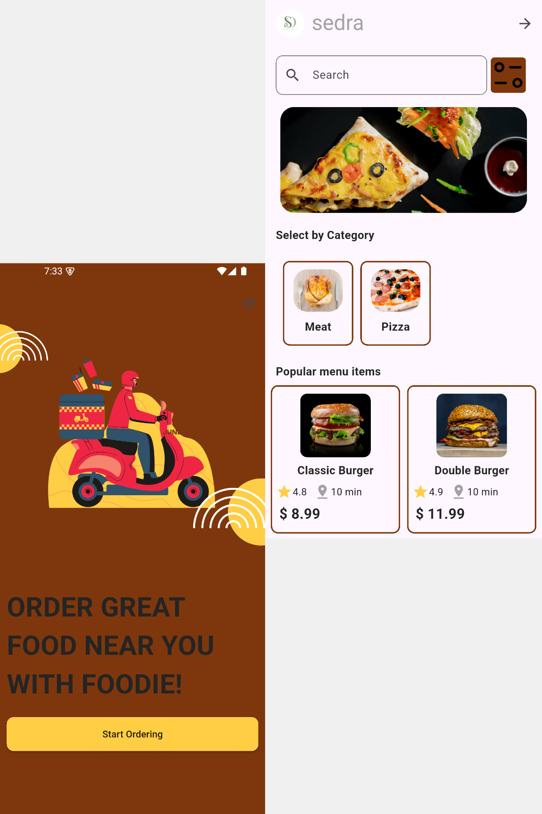
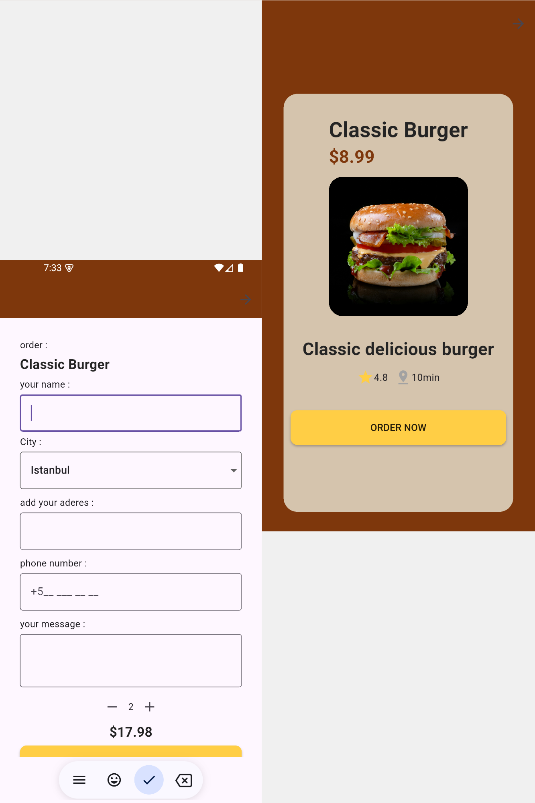
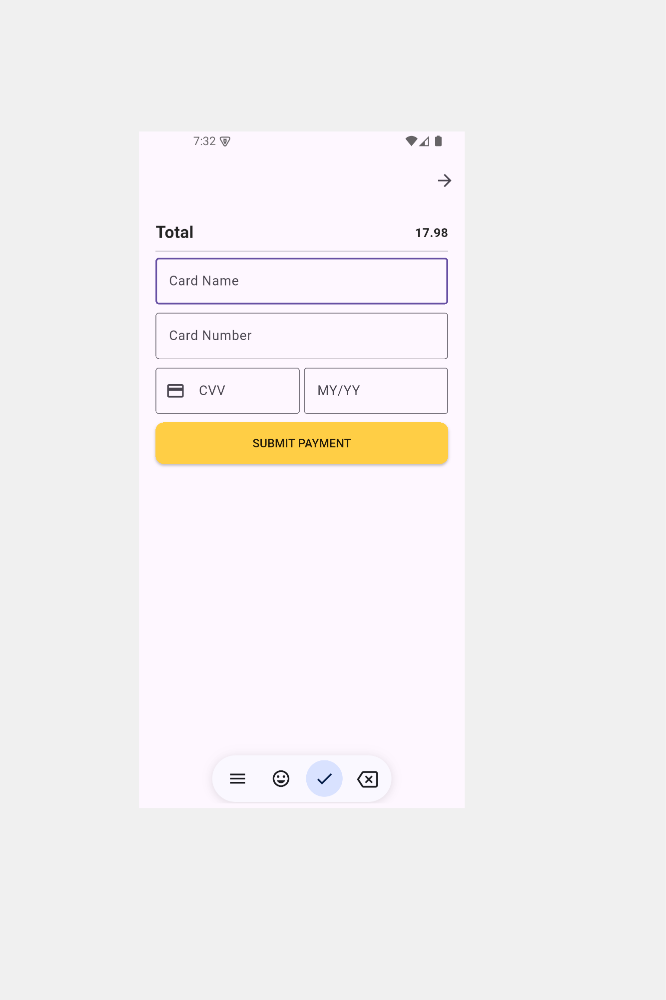

# 🍔 Food Delivery App

A food delivery application built using **Flutter**, **PHP**, and **MySQL**, allowing users to browse products, place orders, and complete a demo payment process.

---

## 🚀 Features

- 🍔 Browse food products from MySQL database
- 📋 View product details
- 🔢 Select product quantity
- 📍 Enter delivery information
- 🛒 Place and save orders
- 💳 Save payment records
- 🔗 Connect Flutter with PHP REST API
- ⚡ Dynamic product and order data

---

## 🛠️ Tech Stack

- **Flutter (Dart)**
- **PHP**
- **MySQL**
- **REST API**

---

## 📸 Screens

- Home Screen
- Product Details Screen
- Location Screen
- Payment Details Screen
- Order Completed Screen

---

## ⚙️ Design Overview

---
